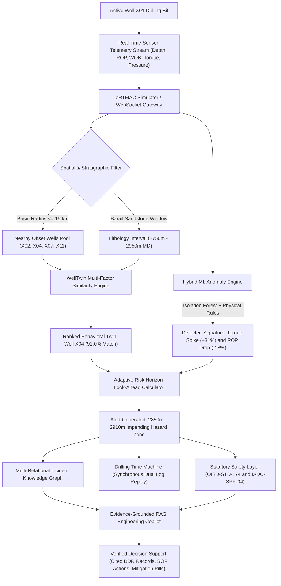
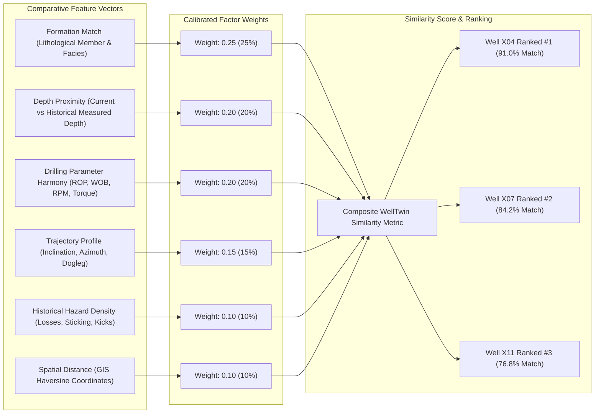
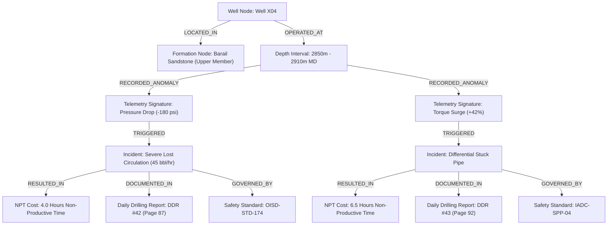
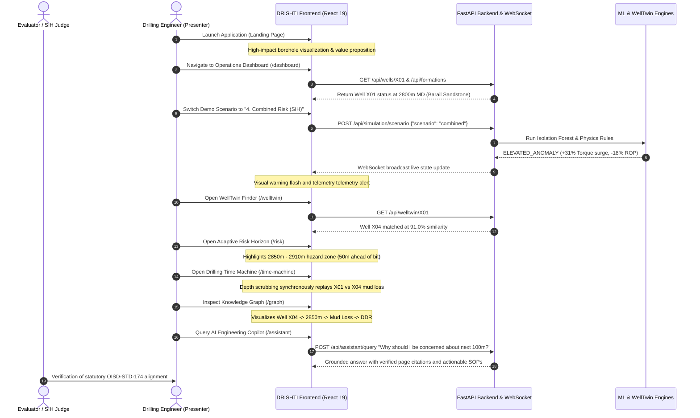

# DRISHTI-NWIS

<div align="center">

# 🛢️ DRISHTI-NWIS
### **Drilling Risk Intelligence & Safety History Interface**
**Nearby Wells Intelligence & Explainable Decision-Support Platform for Drilling Operations**  
*Developed for Smart India Hackathon (SIH 2026) | Problem Statement: SIH121*

[](https://fastapi.tiangolo.com)
[](https://react.dev)
[](https://www.typescriptlang.org)
[](https://vitejs.dev)
[](https://scikit-learn.org)
[](https://www.docker.com)
[](https://www.oisd.gov.in)

> *"Learn from every well. Anticipate the next risk."*

</div>

---

## 📑 Table of Contents

- [1. Executive Summary & Problem Statement](#1-executive-summary--problem-statement)
- [2. System Architecture & Diagrams](#2-system-architecture--diagrams)
  - [2.1 High-Level Architecture](#21-high-level-architecture)
  - [2.2 End-to-End Operational Pipeline](#22-end-to-end-operational-pipeline)
  - [2.3 WellTwin Multi-Factor Similarity Model](#23-welltwin-multi-factor-similarity-model)
  - [2.4 Incident Knowledge Graph Ontology](#24-incident-knowledge-graph-ontology)
  - [2.5 Judge Demonstration Sequence](#25-judge-demonstration-sequence)
- [3. Key Modules & Technical Capabilities](#3-key-modules--technical-capabilities)
- [4. Repository Structure](#4-repository-structure)
- [5. API & WebSocket Specification](#5-api--websocket-specification)
- [6. Getting Started & Installation](#6-getting-started--installation)
  - [6.1 Prerequisites](#61-prerequisites)
  - [6.2 Option A: One-Click Windows Launch](#62-option-a-one-click-windows-launch)
  - [6.3 Option B: Manual Execution](#63-option-b-manual-execution)
  - [6.4 Option C: Docker Compose](#64-option-c-docker-compose)
- [7. SIH 2026 Judge Demonstration Script (4–6 Minutes)](#7-sih-2026-judge-demonstration-script-46-minutes)
- [8. Safety Compliance & Statutory Disclaimers](#8-safety-compliance--statutory-disclaimers)

---

## 1. Executive Summary & Problem Statement

In oil and gas exploration, drilling unexpected hazard zones causes catastrophic **Non-Productive Time (NPT)**, equipment losses, and wellbore instability costing between **$50,000 to $150,000 per day**.

While upstream operators drill dozens of offset wells within the same basin, **historical drilling intelligence remains locked away** in unstructured Daily Drilling Reports (DDRs), post-well review PDFs, and disparate sensor silos. Real-time rig telemetry (eRTMAC) monitors the current bit, but lacks contextual look-ahead foresight from nearby wells that encountered the exact same formation depths years earlier.

**DRISHTI-NWIS** bridges this critical operational gap:
1. **Digests Historical Offset Memory:** Automatically extracts incidents, mud losses, stuck pipe occurrences, and torque anomalies from offset wells (Upper Assam Basin / Barail Sandstone).
2. **Behavioral WellTwin Matching:** Computes a 6-vector weighted similarity index to identify historical analog wells with up to **91.0% behavioral concordance**.
3. **ML + Physics Anomaly Detection:** Combines **Isolation Forest** unsupervised learning with thermodynamic and hydraulic threshold checks.
4. **Adaptive Look-Ahead Risk Horizon:** Projects an automated 50m–150m alert envelope ahead of the current bit position to prevent downhole surprises.
5. **Incident Knowledge Graph & Time Machine:** Traces root causes back to source DDR records and synchronously replays historical twin logs against live sensor data.
6. **Evidence-Grounded RAG Copilot:** Delivers verifiable, page-cited operational SOPs grounded in **OISD-STD-174** and **IADC** guidelines.

---

## 2. System Architecture & Diagrams

### 2.1 High-Level Architecture

The platform is designed around a modular microservice architecture decoupling real-time sensory simulation, ML inference, graph reasoning, and modern high-frequency frontend rendering.

```mermaid
graph TB
    subgraph Frontend["Frontend Layer (React 19 + TypeScript + Vite)"]
        UI_Dash["Operations Dashboard & Stratigraphic Column"]
        UI_Live["Live Telemetry Monitor & WebSocket Subscriber"]
        UI_Twin["WellTwin Similarity Matrix & Radar Visualizer"]
        UI_Risk["Adaptive Risk Horizon Dynamic Look-Ahead"]
        UI_TM["Drilling Time Machine (Synchronous Dual Replay)"]
        UI_Graph["Incident Knowledge Graph (Interactive Canvas)"]
        UI_RAG["Evidence-Grounded AI Engineering Copilot"]
        UI_Safety["OISD & DGMS Statutory Safety Catalog"]
    end

    subgraph Communication["Communication & API Gateway"]
        REST["FastAPI REST Endpoints (/api/*)"]
        WS["Bidirectional WebSocket (/api/live/{well_id}/stream)"]
    end

    subgraph BackendEngines["Backend Intelligence Core (FastAPI + Python 3.11)"]
        Sim["eRTMAC Telemetry Simulation Engine"]
        ML_Anomaly["ML Anomaly Detector (Isolation Forest + Physics Rules)"]
        WellTwin["WellTwin Multi-Factor Similarity Engine"]
        RiskHorizon["Adaptive Look-Ahead Risk Horizon Calculator"]
        GraphEngine["Incident Knowledge Graph Ontology Engine"]
        RAGEngine["Evidence-Grounded RAG Assistant Engine"]
    end

    subgraph DataStores["Data & Domain Knowledge Stores"]
        WellsDB["Spatial Well Registry (Upper Assam Basin)"]
        StratDB["Stratigraphic Formations & Lithology Column"]
        IncidentDB["Historical Incidents & NPT Event Records"]
        DDR_Store["Daily Drilling Reports (DDR PDFs & Chunks)"]
        Safety_Store["OISD-STD-174 & IADC Safety Reference Library"]
    end

    Frontend <--> Communication
    Communication <--> BackendEngines
    BackendEngines <--> DataStores
```



---

### 2.2 End-to-End Operational Pipeline

The following flowchart illustrates the continuous decision-support loop from real-time bit sensor ingestion to engineer recommendation:



---

### 2.3 WellTwin Multi-Factor Similarity Model

WellTwin computes behavioral similarity between the active well ($W_{\text{active}}$) and historical offset wells ($W_{\text{offset}}$) using a calibrated six-factor weighted formulation:

$$\text{Similarity}(W_{\text{active}}, W_{\text{offset}}) = \sum_{i=1}^{6} w_i \cdot S_i = 0.25 S_{\text{form}} + 0.20 S_{\text{depth}} + 0.20 S_{\text{param}} + 0.15 S_{\text{traj}} + 0.10 S_{\text{events}} + 0.10 S_{\text{spatial}}$$



| Factor ($S_i$) | Weight ($w_i$) | Metric Formulation & Rationale |
|---|:---:|---|
| **Stratigraphic Formation** | `0.25` | Exact match in regional lithology (Barail Sandstone Upper Member = 1.0; adjacent siltstone = 0.6). |
| **Depth Proximity** | `0.20` | Normalized exponential decay based on $|Depth_{\text{active}} - Depth_{\text{offset}}|$. |
| **Drilling Parameters** | `0.20` | Cosine similarity across operational telemetry vector: $[ROP, RPM, Torque, WOB, MudWeight, Pressure]$. |
| **Wellbore Trajectory** | `0.15` | Alignment in well profile (vertical vs directional build sections, dogleg severity). |
| **Historical Incidents** | `0.10` | Hazard clustering density and frequency of historical non-productive events. |
| **Spatial Distance** | `0.10` | Haversine surface distance between wellheads (Well X04 is 4.2 km away; X07 is 8.1 km). |

---

### 2.4 Incident Knowledge Graph Ontology

The Incident Knowledge Graph structures drilling memory into a multi-relational ontology connecting wells, formations, depths, anomalous sensor signatures, incidents, NPT costs, and statutory safety documentation:



---

### 2.5 Judge Demonstration Sequence

The interactive demonstration workflow provides an airtight, deterministic evaluation path for Smart India Hackathon evaluators:



---

## 3. Key Modules & Technical Capabilities

### 🎨 Frontend Excellence
- **Core Stack:** React 19, TypeScript, Vite.
- **Industrial Design System:** Custom dark industrial palette (`#030817` deep navy background, `#4DA3FF` electric blue accents, `#FF3B30` risk crimson, `#FF9F0A` hazard amber, `#30D158` nominal green) with subtle glassmorphic glows and JetBrains Mono monospace telemetry numbers.
- **Dynamic Data Visualizers:**
  - **Stratigraphic Borehole Visualizer:** Interactive SVG column displaying real-time bit depth, lithology layers, formation boundaries, and look-ahead risk zones.
  - **Basin Spatial Map:** Leaflet GIS map showing wellhead GPS coordinates, field boundaries, and radial distance rings.
  - **WellTwin Radar & Factors:** Multi-axis visualizers breaking down similarity scores into formation, depth, parameter, trajectory, event, and spatial components.
  - **Synchronous Dual Time Machine:** Dual-axis depth-indexed profile replaying historical WellTwin parameter signatures against current well logs.
- **Deterministic Judge Demo Panel:** Instant scenario switching (`Normal`, `Torque Anomaly`, `Historical Risk`, `Combined Risk`), interactive depth slider (2750m–2950m), playback controls, and a 19-step modal presentation guide.

### 🧠 Backend & Machine Learning
- **Framework:** Python FastAPI with asynchronous WebSocket broadcasting and Pydantic validation.
- **ML Anomaly Detection (`scikit-learn`):**
  - **Isolation Forest Model:** Unsupervised tree ensemble trained on normal drilling distributions in the Barail formation to isolate multidimensional outliers.
  - **Physics-Based Guardrails:** Secondary validation engine flagging specific parameter breaches:
    - Torque deviation $> +20\%$ above baseline (mechanical binding / micro-fractures).
    - Rate of Penetration (ROP) degradation $> -18\%$ (bit balling / dulling).
    - Standpipe Pressure (SPP) drop $> 120\text{ psi}$ (mud loss / fracture initiation).
- **WellTwin Similarity Engine:** Multi-factor vector distance scoring engine calculating similarity across 6 geological, spatial, and telemetry dimensions.
- **Adaptive Look-Ahead Risk Horizon:** Dynamic calculation engine assessing hazard proximity relative to bit position, alerting rig superintendents 50m to 150m prior to entering thief zones.
- **Incident Knowledge Graph:** Graph engine establishing causal relationships between wells, formations, depth thresholds, telemetry signatures, incident types, NPT hours, and DDR documents.
- **Evidence-Grounded RAG Copilot:** Assistant retrieving historical DDR chunks and statutory safety rules to deliver verifiable recommendations with page-level citations.

---

## 4. Repository Structure

```text
sih121/
├── frontend/                               # React 19 + TypeScript + Vite Client
│   ├── src/
│   │   ├── components/                     # Reusable UI Components
│   │   │   ├── DemoControls.tsx            # Judge demo scenario selector & depth slider
│   │   │   ├── GuidedTourModal.tsx         # 19-step guided presentation tour
│   │   │   ├── Header.tsx                  # Global status bar, active well indicator
│   │   │   └── Sidebar.tsx                 # Navigation drawer with route badges
│   │   ├── pages/                          # Complete Application Views
│   │   │   ├── LandingPage.tsx             # Public hero landing page & value proposition
│   │   │   ├── DashboardPage.tsx           # Rig operations central overview
│   │   │   ├── LiveMonitorPage.tsx         # High-frequency telemetry & WebSocket stream
│   │   │   ├── WellExplorerPage.tsx        # GIS basin map & offset well database
│   │   │   ├── WellTwinPage.tsx            # Multi-factor similarity ranking & radar
│   │   │   ├── RiskHorizonPage.tsx         # Look-ahead hazard zone & explainability
│   │   │   ├── TimeMachinePage.tsx         # Synchronous dual-well depth replay
│   │   │   ├── KnowledgeGraphPage.tsx      # Multi-relational incident ontology
│   │   │   ├── SafetyContextPage.tsx       # OISD & DGMS statutory guidelines
│   │   │   ├── AiAssistantPage.tsx         # Evidence-grounded RAG engineering copilot
│   │   │   └── ReportsPage.tsx             # Daily Drilling Reports & PDF inspector
│   │   ├── services/                       # API communication & WebSocket clients
│   │   ├── types/                          # Comprehensive TypeScript interfaces
│   │   ├── App.tsx                         # Client route coordinator & state provider
│   │   ├── main.tsx                        # DOM mount entry point
│   │   └── index.css                       # Industrial design tokens & animations
│   ├── package.json
│   ├── vite.config.ts
│   └── Dockerfile
│
├── backend/                                # FastAPI Python Backend
│   ├── app/
│   │   ├── data/                           # Seed Data & Representative Memory
│   │   │   └── seed_data.py                # Wells, lithology, incidents, DDRs, safety SOPs
│   │   ├── graph/                          # Knowledge Graph Service
│   │   │   └── incident_graph.py           # Multi-relational ontology builder
│   │   ├── ml/                             # Machine Learning Engines
│   │   │   └── anomaly.py                  # Scikit-learn Isolation Forest & physics rules
│   │   ├── models/                         # Pydantic Schemas & DTOs
│   │   │   └── schemas.py                  # Telemetry, Anomaly, WellTwin, Risk schemas
│   │   ├── rag/                            # Retrieval-Augmented Generation
│   │   │   └── assistant.py                # Grounded engineering assistant engine
│   │   ├── services/                       # Core Business Logic
│   │   │   ├── risk_horizon.py             # Adaptive look-ahead hazard calculator
│   │   │   ├── simulation.py               # Deterministic eRTMAC telemetry simulator
│   │   │   └── welltwin.py                 # Multi-factor WellTwin similarity service
│   │   └── main.py                         # FastAPI routes & WebSocket endpoint
│   ├── requirements.txt
│   └── Dockerfile
│
├── docs/                                   # Detailed Engineering Specifications
│   ├── workflow.md                         # 20-point engineering workflow specification
│   ├── build.md                            # Architecture, stack and build guidelines
│   └── design.md                           # Visual direction, color palette and UI guidelines
│
├── docker-compose.yml                      # Container orchestration for full stack
├── run_dev.bat                             # One-click Windows launch script
└── README.md                               # Project documentation & presentation guide
```

---

## 5. API & WebSocket Specification

The FastAPI backend exposes comprehensive RESTful endpoints and high-throughput WebSocket streams:

### 📡 Core REST Endpoints

| Method | Endpoint | Description | Request / Query Parameters | Response Model |
|:---:|---|---|---|---|
| `GET` | `/api/wells` | List active well (X01) and all offset historical wells | None | `List[Well]` |
| `GET` | `/api/wells/{well_id}` | Retrieve specific well details, live telemetry, and risks | `well_id: str` | `WellDetail` |
| `GET` | `/api/wells/{well_id}/nearby` | Spatial query returning wells within specified radius | `radius: float = 15.0` | `List[Well]` |
| `GET` | `/api/formations` | Stratigraphic formation columns & lithology boundaries | None | `List[Formation]` |
| `GET` | `/api/incidents` | All historical field incidents and NPT logs | None | `List[IncidentEvent]` |
| `GET` | `/api/live/{well_id}` | Current live telemetry, anomaly status, and risk horizon | `well_id: str` | `SimulationState` |
| `POST` | `/api/simulation/scenario` | Switch deterministic demo scenario | `{"scenario": "normal" \| "torque" \| "risk" \| "combined"}` | `SimulationState` |
| `POST` | `/api/simulation/depth` | Manually scrub active well bit depth (2750m–2950m) | `{"depth": 2850.0}` | `SimulationState` |
| `POST` | `/api/simulation/step` | Single-step simulation advance (+1.0m) | None | `SimulationState` |
| `POST` | `/api/simulation/start` | Start automatic continuous simulation | None | `{"status": "running"}` |
| `POST` | `/api/simulation/pause` | Pause continuous simulation | None | `{"status": "paused"}` |
| `POST` | `/api/simulation/reset` | Reset simulation to baseline (2800m, normal) | None | `SimulationState` |
| `GET` | `/api/welltwin/{well_id}` | Ranked WellTwin similarity results | `well_id: str` | `List[WellTwinResult]` |
| `GET` | `/api/welltwin/{well_id}/detail` | Detailed factor breakdown for a specific twin | `well_id: str` | `WellTwinDetail` |
| `GET` | `/api/risk/{well_id}` | Look-ahead risk horizon assessment for active depth | `well_id: str` | `RiskHorizonZone` |
| `GET` | `/api/anomalies/{well_id}` | Isolation Forest & physics anomaly diagnostic | `well_id: str` | `AnomalyResult` |
| `GET` | `/api/graph/{well_id}` | Nodes and edges for Incident Knowledge Graph | `well_id: str = "X04"` | `GraphData` |
| `GET` | `/api/timemachine/{well_id}` | Synchronous depth logs for dual-well replay | `well_id: str = "X04"` | `TimeMachineData` |
| `GET` | `/api/safety` | Catalog of OISD, DGMS, and IADC safety SOPs | None | `List[SafetyReference]` |
| `GET` | `/api/reports` | Index of historical Daily Drilling Reports (DDRs) | None | `List[Report]` |
| `POST` | `/api/assistant/query` | RAG AI engineering copilot with verified citations | `{"query": str, "well_id": str, "current_depth": float}` | `AssistantQueryResponse` |

### ⚡ WebSocket Stream
- **Endpoint:** `ws://localhost:8000/api/live/{well_id}/stream`
- **Protocol:** JSON text frames streamed at 1.5-second intervals.
- **Payload Schema:**
  ```json
  {
    "current_well_id": "X01",
    "depth": 2845.0,
    "telemetry": {
      "rop": 14.8,
      "rpm": 118.0,
      "torque": 55.4,
      "wob": 14.2,
      "mud_weight": 1.18,
      "pressure": 3190.0,
      "flow_rate": 2200.0,
      "standpipe_pressure": 3190.0
    },
    "anomaly": {
      "is_anomaly": true,
      "status": "ELEVATED_ANOMALY",
      "anomaly_score": -0.142,
      "confidence": 88.5,
      "explanations": ["Torque +30.4% above baseline", "Isolation Forest score below threshold"],
      "features_flagged": ["torque"]
    },
    "risk_horizon": {
      "risk_level": "CRITICAL",
      "start_depth": 2850.0,
      "end_depth": 2910.0,
      "distance_to_risk": 5.0,
      "is_inside_zone": false,
      "summary": "Imminent High Risk Thief Zone 5m ahead",
      "contributing_wells": ["X04", "X07", "X11"]
    }
  }
  ```

---

## 6. Getting Started & Installation

### 6.1 Prerequisites
- **Node.js:** v18.0.0 or higher
- **Python:** v3.10 or higher
- **Package Managers:** `npm` and `pip`
- **Docker & Docker Compose:** *(Optional, for containerized execution)*

---

### 6.2 Option A: One-Click Windows Launch

For immediate evaluation on Windows systems, double-click or run the included batch launcher:

```powershell
.\run_dev.bat
```

This concurrently boots:
- The **FastAPI Backend** on `http://localhost:8000` (Interactive Swagger Docs at `http://localhost:8000/docs`)
- The **Vite Frontend** on `http://localhost:5173`

---

### 6.3 Option B: Manual Execution

#### 1. Start the Backend:
```bash
# Navigate to backend directory
cd backend

# Create virtual environment (recommended)
python -m venv venv
# Windows:
venv\Scripts\activate
# Linux/macOS:
source venv/bin/activate

# Install dependencies
pip install -r requirements.txt

# Run FastAPI server
uvicorn app.main:app --host 0.0.0.0 --port 8000 --reload
```

#### 2. Start the Frontend:
```bash
# Navigate to frontend directory in a separate terminal
cd frontend

# Install npm dependencies
npm install

# Start development server
npm run dev
```

Open your browser to: **`http://localhost:5173`**

---

### 6.4 Option C: Docker Compose

To run the complete production-grade containerized stack:

```bash
docker-compose up --build
```

- **Frontend:** Accessible at `http://localhost:5173`
- **Backend API:** Accessible at `http://localhost:8000`

---

## 7. SIH 2026 Judge Demonstration Script (4–6 Minutes)

For a deterministic presentation that highlights all technical innovations, use the **SIH Demo Script** in the navigation bar or execute the following sequence:

| Step | Page & Action | Key Technical Demonstration | Expected Metric / Evidence |
|:---:|---|---|---|
| **1** | **Landing Page (`/`)** | Introduce the core thesis: *"Learn from every well. Anticipate the next risk."* | Hero borehole animation and value proposition. |
| **2** | **Operations Dashboard (`/dashboard`)** | Click **"Open Operations"**. Inspect Well X01 at 2800m in the Barail Sandstone Upper Member. | Depth: 2800m, ROP: 18.2 m/hr, Torque: 42.5 kN·m, Normal status. |
| **3** | **Live Monitor (`/live`)** | Start live stream. Switch Demo Scenario to **"4. Combined Risk (SIH)"**. | Real-time WebSocket gauges update dynamically. |
| **4** | **Anomaly Observation** | Observe torque surging from 42.5 to 58+ kN·m (+31% delta) and ROP dropping. | Isolation Forest flags `ELEVATED_ANOMALY` with explainability notes. |
| **5** | **WellTwin Finder (`/welltwin`)** | Navigate to WellTwin. Reveal behavioral twin ranking. | Well **X04** identified with **91.0% match** (Formation 95%, Depth 92%). |
| **6** | **Adaptive Risk Horizon (`/risk`)** | Highlight the upcoming **2850m – 2910m hazard zone**. Show bit advancing to 2845m (5m away) and 2855m (inside thief zone). | Dynamic look-ahead alert escalates from `MODERATE` to `CRITICAL`. |
| **7** | **Explainability Dossier** | Click **"Why was this alert raised?"** to inspect contributing offset wells. | Traces 3 offset wells (X04, X07, X11) and 15.7 hours of historical NPT. |
| **8** | **Basin Map (`/wells`)** | Review GIS coordinates and spatial distance rings relative to X01. | Wellhead positions in Upper Assam Basin. |
| **9** | **Time Machine (`/time-machine`)** | Scrub depth slider to 2850m and 2910m to synchronously replay X04 historical data. | Dual-well sync replay of circulation loss and sticking. |
| **10** | **Incident Knowledge Graph (`/graph`)** | Trace graph nodes: `Well X04 → Barail Sandstone → 2850m → SPP Loss -180 psi → Mud Loss → NPT 4.0h → DDR #42 p.87`. | Visual multi-relational graph proof. |
| **11** | **Safety Context (`/safety`)** | Review mandatory pre-kick and stuck pipe procedures. | Compliance with `OISD-STD-174` and `IADC-SPP-04`. |
| **12** | **AI Engineering Copilot (`/assistant`)** | Query: *"Why should I be concerned about the next 100m?"* | Verifiable citations (`X04_Drilling_Report.pdf` p.87, p.92) & SOP actions. |
| **13** | **Dashboard (`/dashboard`)** | Return to dashboard. Summarize the closed-loop prevention of a 6.5h stuck pipe event. | Demonstrates massive NPT cost reduction. |

---

## 8. Safety Compliance & Statutory Disclaimers

### 🛡️ Statutory Reference Layer
DRISHTI-NWIS integrates codified standards from Indian and international petroleum governing authorities:
- **OISD-STD-174:** Well Control Operations, Casing Seat Integrity, and Mud Density Management.
- **DGMS (Directorate General of Mines Safety):** Rig Floor Mechanical Handling, Rotating Equipment Clearances, and BOP Drill Schedules.
- **IADC-SPP-04:** International Association of Drilling Contractors Guidelines on Differential Sticking Mitigation.

### ⚠️ Prototype & Benchmark Notice
> **Notice:** DRISHTI-NWIS is an advanced engineering prototype developed for the Smart India Hackathon (SIH 2026). It serves as a **decision-support intelligence interface** for drilling engineers and superintendents. It does not exert autonomous control over rig mechanical drives or surface choke manifolds. All well parameters, lithological profiles, and DDR records are representative synthetic industrial benchmarks.

---

<div align="center">

**DRISHTI-NWIS** — *Engineering Foresight for Safer, Smarter Drilling Operations.*  
*Smart India Hackathon 2026 | Team SIH121*

</div>
